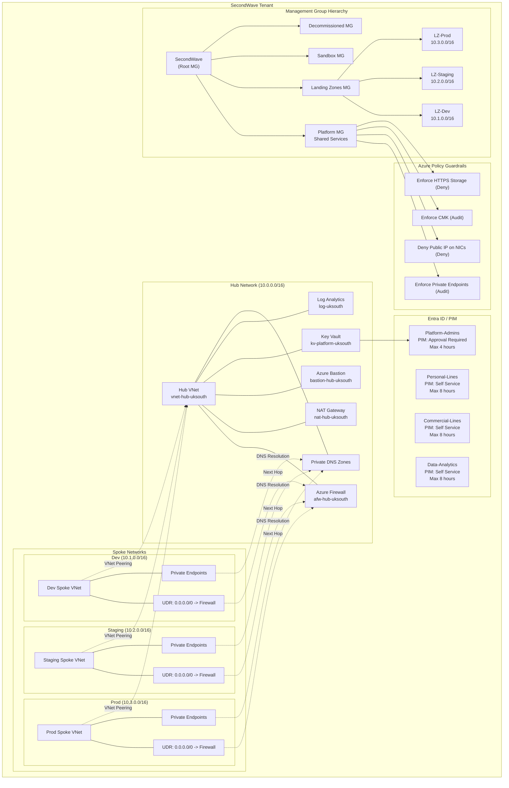

# SecondWave Azure Landing Zone

**Enterprise-grade Azure CAF Landing Zone for a 350-person UK Insurer (FCA/PRA regulated)**

## Scenario: SecondWave Insurance

SecondWave Insurance is a 350-employee UK general insurer undergoing digital transformation. They are migrating from a colocated data centre to Azure under the following constraints:

- **Regulated**: Authorised by FCA and PRA (SYSC 6.1, SS2/21)
- **Data residency**: All customer data must remain in UK (UK South primary, UK West DR)
- **3 value streams**: Personal Lines, Commercial Lines, Data & Analytics
- **Identity**: Microsoft 365 E5 with Azure AD P2 (PIM enabled)
- **Compliance**: UK GDPR, FCA rules, PRA operational resilience requirements

This landing zone provides the foundation for workload migration with built-in security, governance, and operational excellence.

## Architecture



## Architecture Decisions

| ID | Decision | Rationale | Alternative Considered |
|----|----------|-----------|----------------------|
| ADR-001 | Hub-Spoke over Virtual WAN | Cost predictability, team expertise, simpler auditability for FCA | Azure Virtual WAN |
| ADR-002 | Private Endpoints over Service Endpoints | True network isolation, data exfiltration prevention, works cross-region | Service Endpoints |
| ADR-003 | Azure Firewall over NVA | Zero management overhead, native Azure integration, predictable cost | Palo Alto, Zscaler NVA |
| ADR-004 | CAF Management Groups | Policy inheritance, subscription organisation, cost aggregation | Flat subscriptions |
| ADR-005 | Single Log Analytics workspace | Cost efficiency, simplified KQL queries, single Sentinel instance | Per-environment workspaces |
| ADR-006 | RBAC Key Vault over Access Policies | PIM integration, fine-grained control, auditability | Legacy access policies |
| ADR-007 | Azure DNS over Private DNS Resolver | Native Private Endpoint integration, no custom server management | Azure Private DNS Resolver |

## Security Safeguards

| Safeguard | Mechanism | Enforced By |
|-----------|-----------|-------------|
| **No public PaaS access** | Private Endpoints + Azure Policy (Audit) | `modules/azure-policy` |
| **No public IPs on VMs** | Azure Policy (Deny) | `modules/azure-policy` |
| **CMK encryption** | Azure Policy (Audit) + Key Vault | `modules/azure-policy`, `modules/key-vault` |
| **HTTPS-only storage** | Azure Policy (Deny) | `modules/azure-policy` |
| **Forced tunnelling** | UDR 0.0.0.0/0 -> Azure Firewall | `modules/spoke-network` |
| **Egress inspection** | Azure Firewall with threat intel | `modules/hub-network` |
| **No public Key Vault** | Network ACLs deny public traffic | `modules/key-vault` |
| **Key Vault soft-delete** | 90-day retention + purge protection | `modules/key-vault` |
| **Just-in-time admin** | PIM eligibility + approval workflow | `modules/entra-id` |
| **State file security** | CMK encryption + RBAC auth + no public access | `scripts/bootstrap-backend.sh` |
| **CI/CD OIDC auth** | Federated workload identity (no secrets) | `.github/workflows/*.yml` |

## Deployment Steps

### Prerequisites

- Azure subscription with Contributor access
- Azure AD P2 license (for PIM)
- Azure CLI installed (`az login`)
- Terraform ~> 1.9
- GitHub repository with OIDC federated credentials configured

### 1. Bootstrap State Storage

```bash
./scripts/bootstrap-backend.sh rg-terraform-state uksouth 7k9m2
```

Update the backend block in `versions.tf` with the output values.

### 2. Configure Variables

```bash
cp terraform.tfvars.example terraform.tfvars
# Edit terraform.tfvars with your subscription ID, tenant ID
```

### 3. Deploy Landing Zone

```bash
# Dev
terraform init -backend-config="envs/dev/backend.tfvars"
terraform plan -var-file="envs/dev/terraform.tfvars"
terraform apply -var-file="envs/dev/terraform.tfvars"

# Staging (after dev validation)
terraform init -reconfigure -backend-config="envs/staging/backend.tfvars"
terraform plan -var-file="envs/staging/terraform.tfvars"
terraform apply -var-file="envs/staging/terraform.tfvars"

# Prod (after staging validation)
terraform init -reconfigure -backend-config="envs/prod/backend.tfvars"
terraform plan -var-file="envs/prod/terraform.tfvars"
terraform apply -var-file="envs/prod/terraform.tfvars"
```

### 4. Configure PIM Eligibility

PIM assignments are defined in `modules/entra-id/main.tf`. Update the `principal_id` to match your team members or use the Azure Portal to manage PIM eligibility after deployment.

### 5. CI/CD Setup

1. Create GitHub Environments: `dev`, `staging`, `prod`
2. Configure required reviewers for `staging` and `prod` environments
3. Set up OIDC federated credentials in Azure AD:
   - Azure AD Enterprise Application
   - Federated identity for GitHub Actions
4. Add GitHub Secrets:
   - `AZURE_CLIENT_ID`: Application (client) ID
   - `AZURE_TENANT_ID`: Tenant ID
   - `AZURE_SUBSCRIPTION_ID`: Subscription ID

## Trade-offs and Alternatives

### What we sacrificed

- **Multi-region simplicity**: Single-region hub means DR requires manual failover
- **Advanced TLS inspection**: Only prod gets Premium Firewall with TLS inspection
- **Third-party NVA features**: No Palo Alto/Check Point deep packet inspection
- **Virtual WAN global transit**: Future multi-region will require additional work

### When to revisit

1. **Acquisition/merger**: If SecondWave acquires another insurer, Virtual WAN may be needed for global transit
2. **PCI DSS scope**: If credit card data enters scope, a Palo Alto NVA may be required for PCI compliance
3. **Cost explosion**: If firewall data processing costs exceed forecasts, evaluate Standard SKU or optimize rules
4. **Scale beyond 500 employees**: Hub-spoke with a single firewall may need load-balanced firewalls

## DR and Business Continuity

| Scenario | RTO | RPO | Runbook |
|----------|-----|-----|---------|
| UK South region outage | 4 hours | 1 hour | `docs/runbooks/state-storage-failover.md` |
| Firewall failure | 2 hours | 15 minutes | `docs/runbooks/firewall-recovery.md` |
| Key Vault compromise | 1 hour | Real-time | Azure support ticket + PIM break-glass |
| Accidental state deletion | 4 hours | 24 hours | Restore from DR storage account backup |

## Cost Governance

- **Infracost**: Run `infracost breakdown --path . --config-file .infracost.yml` to estimate costs
- **Azure Budgets**: Set up budgets at Management Group level per environment
- **Dev cost controls**: Standard SKU firewall, shorter log retention, single-region only
- **Prod cost drivers**: Premium Firewall, 730-day retention, DDoS Protection Plan

## Compliance Mapping

| Regulation | Requirement | Implementation |
|-----------|-------------|----------------|
| FCA SYSC 6.1.1 | Data security | Private Endpoints, CMK, HTTPS enforcement |
| FCA SYSC 6.1.2 | Monitoring | Sentinel SIEM, Log Analytics diagnostics |
| FCA SYSC 6.1.4 | Access controls | PIM, RBAC, Bastion, NSGs |
| PRA SS2/21 | Operational resilience | DR runbooks, zone-redundant resources |
| UK GDPR Art 32 | Security of processing | Encryption, access controls, audit logs |
| UK GDPR Art 33 | Breach notification | Sentinel alerts configured |

## Repository Structure

```
.
├── .github/workflows/
│   ├── terraform-plan.yml          # PR validation with OIDC
│   └── terraform-apply.yml         # Apply with manual gates
├── docs/
│   ├── ADR/
│   │   ├── 001-hub-spoke-over-virtual-wan.md
│   │   ├── 002-private-endpoints-over-service-endpoints.md
│   │   └── 003-azure-firewall-over-nva.md
│   └── runbooks/
│       ├── state-storage-failover.md
│       └── firewall-recovery.md
├── envs/
│   ├── dev/     (backend.tfvars, terraform.tfvars)
│   ├── staging/ (backend.tfvars, terraform.tfvars)
│   └── prod/    (backend.tfvars, terraform.tfvars)
├── modules/
│   ├── management-groups/   # CAF MG hierarchy
│   ├── hub-network/         # Hub VNet, Firewall, Bastion, NAT
│   ├── spoke-network/       # Workload VNets with forced tunnelling
│   ├── private-dns/         # Private DNS Zones for Private Link
│   ├── log-analytics/       # Log Analytics + Sentinel
│   ├── key-vault/           # Key Vault + Private Endpoint
│   ├── entra-id/            # Entra ID groups + PIM (AzAPI)
│   └── azure-policy/        # Custom Policy initiatives
├── observability/
│   ├── azure-monitor-dashboard.json
│   └── log-alert-rules.json
├── scripts/
│   └── bootstrap-backend.sh
├── tests/
│   ├── hub_network_test.go   # Terratest stubs
│   └── key_vault_test.go     # Terratest stubs
├── main.tf                 # Root module
├── variables.tf
├── outputs.tf
├── versions.tf
├── terraform.tfvars.example
├── .tflint.hcl
├── .checkov.yml
├── .pre-commit-config.yaml
├── .infracost.yml
├── .tool-versions
├── .gitignore
├── .editorconfig
└── README.md
```
